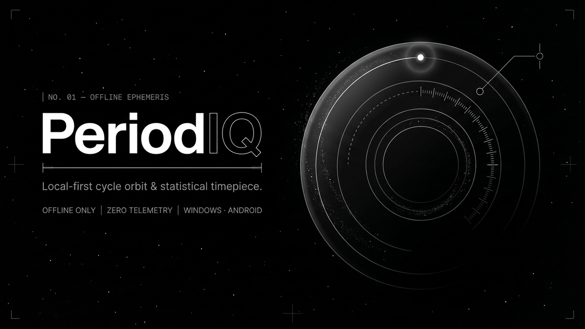
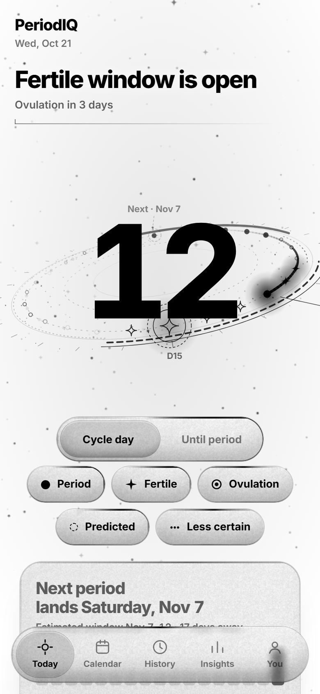
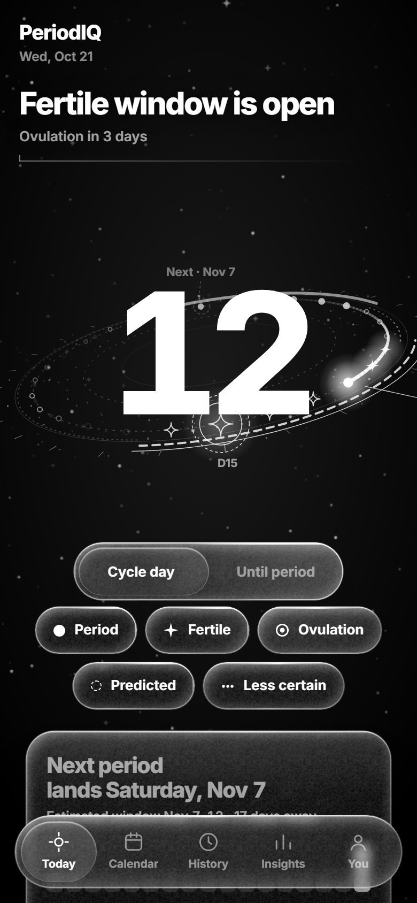
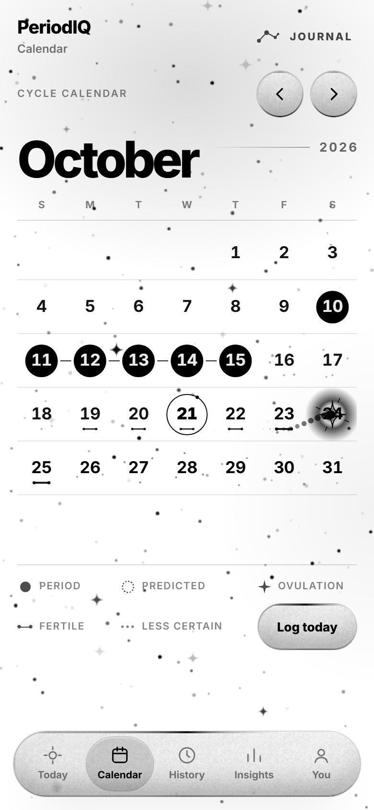
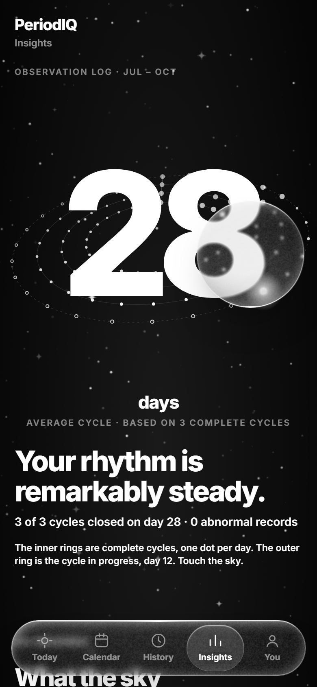
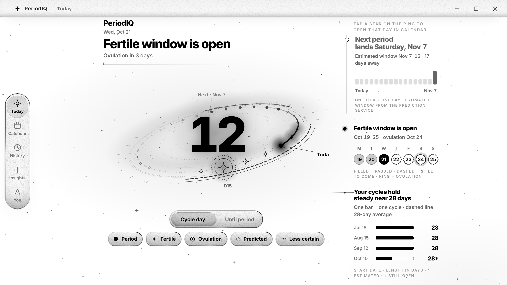
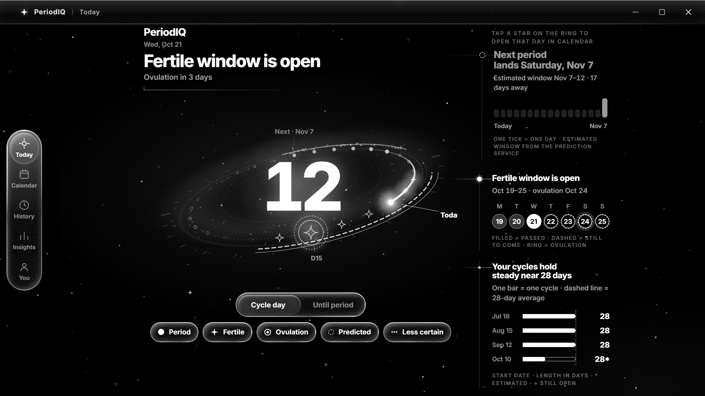

<div align="center">



<br />

# PeriodIQ

**Private. Offline. Yours.**
A local-first period tracking and statistical cycle prediction app for **Windows** and **Android**.

[](https://github.com/Yui-0818/PeriodIQ/actions/workflows/ci.yml)
[-3DDC84?logo=android&logoColor=white)](#download)
[-0078D6?logo=windows&logoColor=white)](#download)
[](LICENSE)
[](PRIVACY.md)

**English** · [简体中文](README_zh.md) · [Privacy Policy](PRIVACY.md) · [Commercial Licensing](COMMERCIAL.md)

</div>

---

## Why PeriodIQ?

Most cycle trackers upload your most intimate health records to cloud servers, monetize behavioral telemetry, or require mandatory accounts. **PeriodIQ is engineered from the ground up so your data never leaves your device.**

| Guarantee | PeriodIQ | Typical Cloud Trackers |
|---|---|---|
| **Storage** | 100% local SQLite on your device | Remote cloud servers |
| **Android Network Permission** | **None** (`INTERNET` is not declared) | Full network & background sync |
| **Windows Network Binding** | `127.0.0.1` loopback only, zero outbound HTTP | Cloud APIs & CDNs |
| **Accounts / Telemetry / Ads** | Zero accounts, zero analytics, zero ads | Required login & tracking SDKs |
| **Data Ownership** | Full JSON/CSV export & snapshot-protected import | Vendor lock-in |

> **Medical Disclaimer**: PeriodIQ is a statistical estimation tool based on historical cycle data. It is **not** a medical device and must not be used for medical diagnosis, treatment, or contraception.

---

## Preview

<div align="center">
  
  <br />
  <sub>Full HD showcase video: <a href="assets/promo.mp4"><code>assets/promo.mp4</code></a></sub>
</div>

### Android 3.2.0 — Light & Dark Modes

<div align="center">
  <table>
    <tr>
      <td align="center"><br /><sub>Today (Light)</sub></td>
      <td align="center"><br /><sub>Today (Dark)</sub></td>
      <td align="center"><br /><sub>Calendar (Light)</sub></td>
      <td align="center"><br /><sub>Insights (Dark)</sub></td>
    </tr>
  </table>
</div>

### Windows Desktop 3.0.8 — Native 16:9 WebView2 Shell

<div align="center">
  <table>
    <tr>
      <td align="center"><br /><sub>Windows Desktop (Light)</sub></td>
      <td align="center"><br /><sub>Windows Desktop (Dark)</sub></td>
    </tr>
  </table>
</div>

---

## Key Features

- **Cycle & Period Logging**: Log start/end dates, cycle lengths, flow intensity, symptoms, and notes effortlessly.
- **Statistical Prediction Engine**: Bayesian & historical statistical model estimating your next period, ovulation window, and prediction error range — implemented in **pure Kotlin** on Android (`3.2.0`) and Python on Windows (`3.0.8`).
- **Interactive Calendar**: Clean monthly view with period, fertile window, and ovulation indicators plus day-level detail sheets.
- **Cycle Insights**: Regularity metrics, cycle length trends, symptom frequency, and mood distributions.
- **Same-Day Journal & Mood**: Private daily journal (write-once on the current day, read-only history) that stays strictly local and is excluded from export packages.
- **Safe Import & Export**: One-click JSON/CSV backup and full-package restore with automatic pre-import local snapshots.
- **Local Reminders (Android)**: Offline scheduled reminder notifications with zero cloud push services.
- **Tri-lingual UI**: Instant switching between **简体中文**, **English**, and **Español**.
- **Light / Dark / System Theme**: Refined typography with bundled `Inter` & `NotoSansSC` fonts and subtle tilt-sensor parallax on Android.

---

## Download

Official pre-built installers are distributed exclusively via **[GitHub Releases](https://github.com/Yui-0818/PeriodIQ/releases)**:

| Platform | Version | Artifact | Requirements |
|---|---|---|---|
| **Android** | `3.2.0` (`versionCode 26`) | `PeriodIQ-3.2.0-release.apk` | Android 8.0+ (API 26+) |
| **Windows** | `3.0.8` | `PeriodIQ-Setup-3.0.8.exe` | Windows 10/11 x64 + WebView2 Runtime |

Verify download integrity against `SHA256SUMS.txt` attached to each release.
- **Android Release Signing Certificate SHA-256**: `b91d5070906b8326ed8603f84f4f55c195fd58699ae29dabd71edb265f57080a`
- **Windows SmartScreen Note**: The Windows installer is distributed unsigned (standard for independent noncommercial software). Verify its SHA-256 hash against the release checksums before running. Uninstalling Windows PeriodIQ **never deletes your local database**.

---

## Architecture & Tech Stack

```text
PeriodIQ/
├─ android/                 # Android 3.2.0 (Pure Kotlin + WebView)
│  ├─ app/                  # Kotlin host, JS bridge, SQLite layer, reminders, pure Kotlin algo/
│  ├─ frontend/             # Vanilla HTML/CSS/JS mobile UI (zero CDN, zero build step)
│  └─ gradle/ & gradlew*    # Self-contained Gradle wrapper with built-in privacy gates
├─ win/                     # Windows 3.0.8 (Frozen release line)
│  ├─ backend/              # Python 3.11 + FastAPI + aiosqlite (binds 127.0.0.1 only)
│  ├─ desktop/              # C# WinForms + WebView2 native 16:9 desktop host
│  └─ frontend/             # Bundled offline desktop UI
└─ assets/                  # Public showcase visuals & promo media
```

---

## Build from Source

### Android (No Python Required)

Requires **JDK 11+** and **Android SDK (API 35)**:

```bash
cd android
# Run JVM unit tests (including statistical algorithm golden vectors)
./gradlew testDebugUnitTest

# Build Debug APK (automatically syncs android/frontend & runs privacy gates)
./gradlew assembleDebug
```

Output: `android/app/build/outputs/apk/debug/app-debug.apk`.
> Release builds (`assembleRelease`) require signing credentials via `-Ppiq.keystore.properties=<path>` or `PIQ_KEYSTORE_PROPERTIES` and fail closed if omitted.

### Windows Desktop

Requires **Python 3.11+** on Windows 10/11 x64:

```powershell
python -m venv .venv
.venv\Scripts\python.exe -m pip install -r win\backend\requirements.txt
.venv\Scripts\python.exe win\desktop\entry.py --windowed
```

Optional: use `MENSTRUAL_DB_PATH` to run with an isolated SQLite database, or `--headless --port 8000` to run the local backend alone. To rebuild the C# native WebView2 host:

```powershell
powershell -ExecutionPolicy Bypass -File win\desktop\build_native_host.ps1
```

---

## License & Commercial Use Policy

PeriodIQ is source-available under the **[PolyForm Noncommercial License 1.0.0](LICENSE)**.

- **Permitted**: Personal use, self-hosting/local builds, academic research, learning, and noncommercial modifications (with attribution and notice retention).
- **Strictly Prohibited Without Authorization**: **Any commercial use of any part of PeriodIQ** — including source code, prediction algorithms, UI/UX assets, compiled binaries, or derivative works — is strictly forbidden without a separate written commercial license from the author.

To request a commercial license, please see **[COMMERCIAL.md](COMMERCIAL.md)** or contact **Yui_0818** at `aaaj6719@gmail.com`.

---

## Security, Privacy & Contributing

- **Privacy Policy**: [PRIVACY.md](PRIVACY.md)
- **Security Policy**: [SECURITY.md](SECURITY.md)
- **Changelog**: [CHANGELOG.md](CHANGELOG.md)
- **Contributing**: [CONTRIBUTING.md](CONTRIBUTING.md) (please review the dual-license contributor terms before opening a PR)
