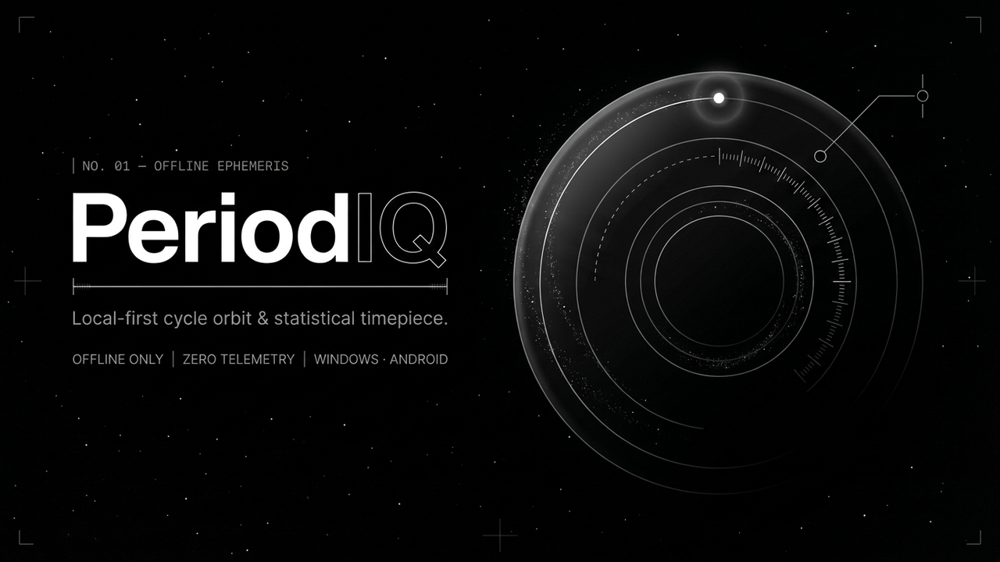
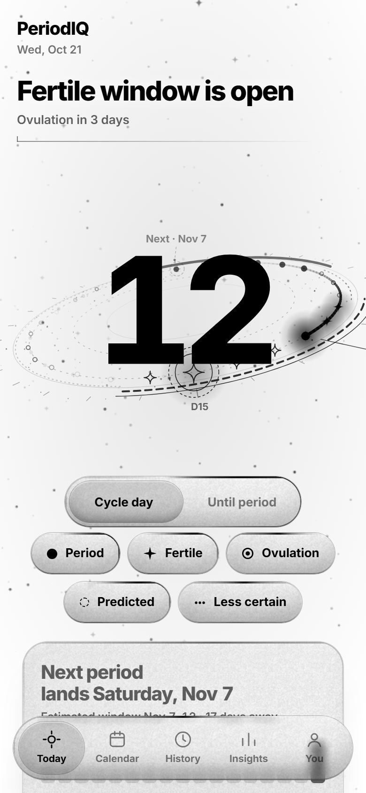
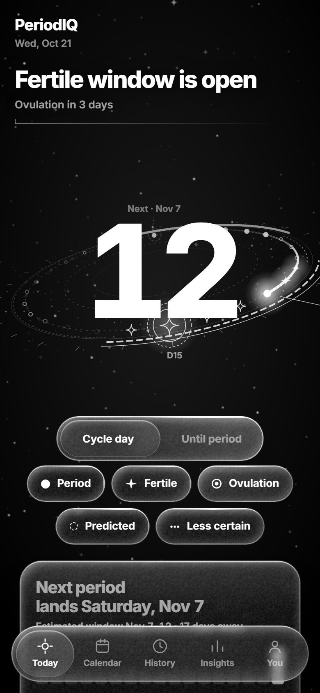
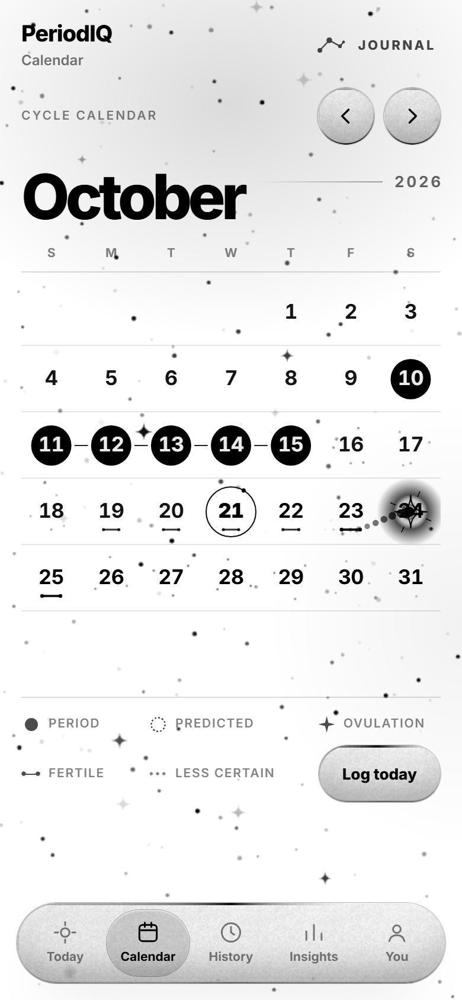
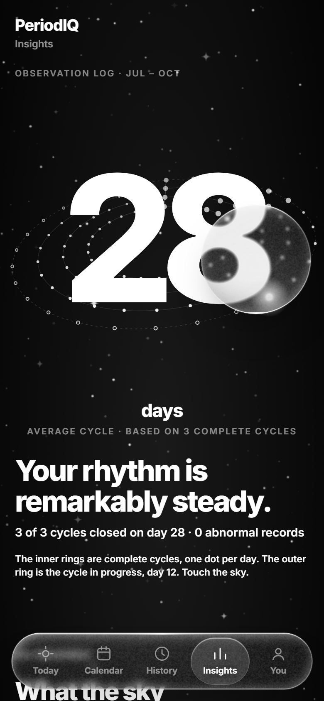
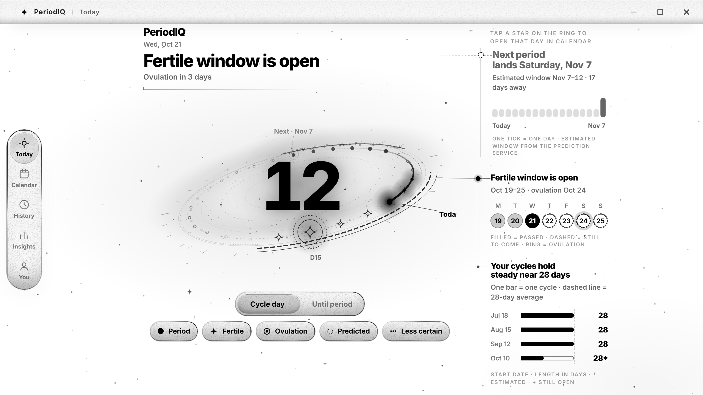
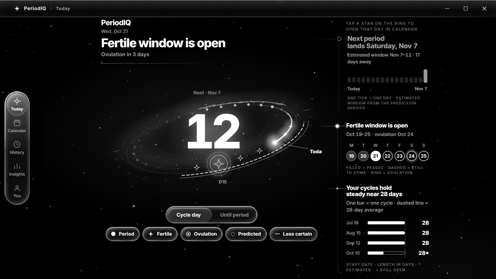

<div align="center">



<br />

# PeriodIQ

**私密、离线、完全属于你。**
一款面向 **Windows** 与 **Android** 的本地优先经期记录与统计预测工具。

[](https://github.com/Yui-0818/PeriodIQ/actions/workflows/ci.yml)
[-3DDC84?logo=android&logoColor=white)](#下载安装)
[-0078D6?logo=windows&logoColor=white)](#下载安装)
[](LICENSE)
[](PRIVACY.md)

[English](README.md) · **简体中文** · [隐私政策](PRIVACY.md) · [商业授权说明](COMMERCIAL.md)

</div>

---

## 为什么选择 PeriodIQ？

市面上绝大多数经期工具都需要注册云账号、把最私密的健康记录上传至云端服务器，甚至夹带广告与行为追踪。**PeriodIQ 从底层架构就确保你的数据永远只留在你自己的设备上。**

| 隐私与安全承诺 | PeriodIQ | 常见云端经期应用 |
|---|---|---|
| **数据存储** | 100% 本机 SQLite 数据库 | 远程云端服务器 |
| **Android 联网权限** | **无**（不声明 `INTERNET` 权限，物理级断网） | 完整联网与后台同步 |
| **Windows 网络监听** | 仅绑定 `127.0.0.1` 回环地址，无任何出站请求 | 云端接口与第三方 CDN |
| **账号 / 遥测 / 广告** | 零账号服务器、零统计上报、零广告 | 强制登录与数据埋点 |
| **数据自主权** | 支持 JSON/CSV 导出，导入前自动创建本地快照 | 平台锁定、难以迁移 |

> **免责声明**：PeriodIQ 仅基于历史周期数据进行统计推算，**不是医疗器械**，输出仅供参考，不能用于医学诊断、治疗或避孕依据。

---

## 产品预览

<div align="center">
  
  <br />
  <sub>高清完整版宣传片：<a href="assets/promo.mp4"><code>assets/promo.mp4</code></a></sub>
</div>

### Android 3.2.0 — 浅色与深色双主题

<div align="center">
  <table>
    <tr>
      <td align="center"><br /><sub>今日视图（浅色）</sub></td>
      <td align="center"><br /><sub>今日视图（深色）</sub></td>
      <td align="center"><br /><sub>月历视图（浅色）</sub></td>
      <td align="center"><br /><sub>统计洞察（深色）</sub></td>
    </tr>
  </table>
</div>

### Windows 桌面端 3.0.8 — 原生 16:9 WebView2 桌面壳

<div align="center">
  <table>
    <tr>
      <td align="center"><br /><sub>Windows 桌面端（浅色）</sub></td>
      <td align="center"><br /><sub>Windows 桌面端（深色）</sub></td>
    </tr>
  </table>
</div>

---

## 核心特性

- **周期与经期记录**：便捷记录开始/结束日期、经期长度、流量、症状与备注。
- **统计预测引擎**：基于贝叶斯与历史统计模型推算下次经期、排卵日与易孕窗口，并展示预测误差区间；Android `3.2.0` 已升级为**纯 Kotlin 算法实现**（告别 Python 运行时，体积更轻、启动更快）。
- **直观月历视图**：清晰标注经期、排卵与易孕期，支持点击任意日期查看与编辑详情。
- **数据洞察**：周期长度趋势、规律性评估、常见症状与心情分布统计。
- **私密日记与心情**：仅限当天书写、历史只读，支持非经期日记录；日记与心情标签默认不随导入导出包流转。
- **安全导入导出**：支持 JSON/CSV 整包备份与替换恢复，导入前自动生成本机快照防误操作。
- **本地提醒（Android）**：纯本地闹钟调度与通知直达，不依赖任何云推送通道。
- **三语即时切换**：完整支持 **简体中文**、**English**、**Español**，切换即时生效。
- **精致视觉体验**：支持浅色 / 深色 / 跟随系统主题，内置离线 `Inter` 与 `NotoSansSC` 字体，Android 端支持细腻的倾斜视差交互。

---

## 下载安装

官方安装包仅通过 **[GitHub Releases](https://github.com/Yui-0818/PeriodIQ/releases)** 发布：

| 平台 | 版本 | 安装包 | 系统要求 |
|---|---|---|---|
| **Android** | `3.2.0`（`versionCode 26`） | `PeriodIQ-3.2.0-release.apk` | Android 8.0+（API 26+） |
| **Windows** | `3.0.8` | `PeriodIQ-Setup-3.0.8.exe` | Windows 10/11 x64，已安装 WebView2 Runtime |

下载后建议对照 Release 中附带的 `SHA256SUMS.txt` 校验文件完整性。
- **Android 正式版签名证书 SHA-256 指纹**：`b91d5070906b8326ed8603f84f4f55c195fd58699ae29dabd71edb265f57080a`
- **Windows SmartScreen 提示说明**：Windows 安装包为独立非商用分发（未购买商业代码签名证书），首次运行若出现 SmartScreen 提示，核对 SHA-256 一致后选择“仍要运行”即可。卸载 Windows 端**不会删除你的本机数据**。

---

## 仓库架构

```text
PeriodIQ/
├─ android/                 # Android 3.2.0（纯 Kotlin + WebView）
│  ├─ app/                  # Kotlin 宿主、JS 桥、SQLite 数据层、本地提醒、纯 Kotlin algo/ 算法
│  ├─ frontend/             # 原生 HTML/CSS/JS 移动端界面（零外链、零前端构建）
│  └─ gradle/ & gradlew*    # 内置前端同步与构建期/打包后隐私闸门的纯 Gradle 构建链
├─ win/                     # Windows 3.0.8（冻结发布线）
│  ├─ backend/              # Python 3.11 + FastAPI + aiosqlite（仅监听 127.0.0.1）
│  ├─ desktop/              # C# WinForms + WebView2 原生 16:9 桌面宿主
│  └─ frontend/             # 离线打包桌面端界面
└─ assets/                  # 公开产品视觉与宣传素材
```

---

## 从源码构建

### Android 端（开箱即编译，无需 Python）

需要 **JDK 11+** 与 **Android SDK（API 35）**：

```bash
cd android
# 运行 JVM 单元测试（含统计算法回归用例）
./gradlew testDebugUnitTest

# 构建 Debug APK（自动同步 android/frontend 并执行构建前/打包后隐私闸门）
./gradlew assembleDebug
```

产物位于：`android/app/build/outputs/apk/debug/app-debug.apk`。
> 构建正式签名版（`assembleRelease`）需通过 `-Ppiq.keystore.properties=<路径>` 或环境变量 `PIQ_KEYSTORE_PROPERTIES` 提供签名配置；缺签名配置时会自动中止，绝不回退 debug 密钥。

### Windows 桌面端

需要 **Python 3.11+**（Windows 10/11 x64）：

```powershell
python -m venv .venv
.venv\Scripts\python.exe -m pip install -r win\backend\requirements.txt
.venv\Scripts\python.exe win\desktop\entry.py --windowed
```

可使用 `MENSTRUAL_DB_PATH` 指定隔离数据库，或加 `--headless --port 8000` 仅启动后端。如需重新编译 C# 原生 WebView2 宿主：

```powershell
powershell -ExecutionPolicy Bypass -File win\desktop\build_native_host.ps1
```

---

## 开源协议与防商用保护声明

PeriodIQ 采用 **[PolyForm Noncommercial License 1.0.0](LICENSE)** 协议公开源码。

- **允许**：个人自用、学习研究、自行编译与非商业性质的修改（须保留版权与协议声明）。
- **严禁未经授权的商业使用**：**任何个人、团队或企业，未经作者事先书面授权，不得将 PeriodIQ 的任何部分（源码、预测算法、UI/UX 资源、编译产物或衍生作品）直接或间接用于任何商业用途。**

如需商业授权，请查看 **[COMMERCIAL.md](COMMERCIAL.md)** 并联系作者 **Yui_0818**：`aaaj6719@gmail.com`。

---

## 隐私、安全与贡献

- **隐私政策**：[PRIVACY.md](PRIVACY.md)
- **安全漏洞报告**：[SECURITY.md](SECURITY.md)
- **更新日志**：[CHANGELOG.md](CHANGELOG.md)
- **贡献指南**：[CONTRIBUTING.md](CONTRIBUTING.md)（提交 PR 前请阅读双重许可贡献条款）
